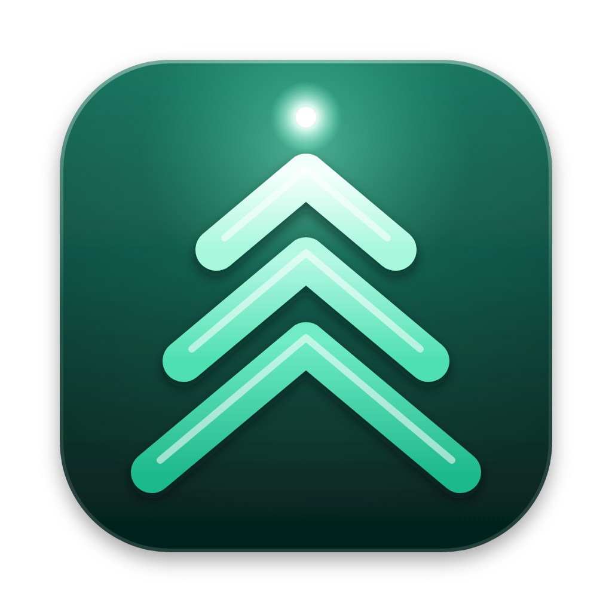

# Spruce: product & design

## Name

**Spruce**, as in *spruce up*: to tidy and smarten. It says what the app does in plain English, it's short and easy to say aloud, and the icon carries both ideas: a spruce tree made of three upward chevrons, which also read as "speed up".

The CLI reads naturally: `spruce clean --sudo`, `spruce uninstall Zoom`, `spruce fleet`.

Tagline: **"Spruce up every Mac you own."**

The app was called Burnish, then Root. Settings, history, logs, the fleet folder, the scheduled clean and the app's preferences move over automatically from either name (`Legacy` in `Sources/SpruceCore/Modules/Fleet.swift`). Names considered in the last round: *Halcyon*, *Fettle*, *Kestrel* (see `docs/redesign/proposal.html`).

## Product principles

1. **Show the receipt.** Nothing is deleted without an itemised list of exactly what goes, how big it is, and whether it goes to the Trash or is gone for good. This fixes the #1 complaint about CleanMyMac.
2. **User first, admin second.** Everything that can run as you runs as you. The **Admin switch** unlocks the system scope. On a standard account (your M3) the toggle is disabled with an explanation, and the app is still fully useful.
3. **Only fix what's broken.** Maintenance tasks probe first. Spotlight gets rebuilt only if search is actually slow, DNS gets flushed only when no VPN is up, permissions get reset only when ownership is actually wrong. That idea comes from Mole.
4. **No placebo.** Spruce doesn't "free RAM", repair permissions, or run periodic scripts on macOS 15+. Where an action has little real effect, the UI says so.
5. **Reversible by default.** Tweaks store the previous value, startup items get *disabled* rather than deleted, and user files go to the Trash.
6. **Fleet aware.** Each Mac publishes a small status file, so every Mac can show all of them.

## Privilege model (the Admin switch)

```
               ┌───────────── Admin switch OFF (or standard account) ─────────────┐
 scan ──► plan ┤  user-scope items ──► FileManager (trash / delete) as you        │
               └──────────────────────────────────────────────────────────────────┘
               ┌───────────── Admin switch ON (admin account) ───────────────────┐
               │  user-scope items ──► as you                                     │
               │  system-scope items ──► ONE generated /bin/sh script             │
               │      shown in the receipt ──► one auth prompt ──► runs as root   │
               └──────────────────────────────────────────────────────────────────┘
```

- **Admin detection:** checks whether you're in the `admin` group (`id -Gn`).
- **App:** with Touch ID set up for sudo (pam_tid in `/etc/pam.d/sudo_local`), runs the script through `sudo` and a fingerprint authorizes it (`TouchIDSudo`). Otherwise, or if Touch ID can't be used right now, it uses one compiled in-process AppleScript (`do shell script … with administrator privileges`). Either way the script is passed as an *argument*, never written to a temp file, and one authorization covers about five minutes.
- **CLI:** runs `sudo /bin/sh -c …`. Touch ID works once you apply the *Touch ID for sudo* tweak (`/etc/pam.d/sudo_local`).
- **The root script is built only from validated, shell-quoted paths and fixed commands.** It never comes from free-form input. That's a deliberate contrast with Pearcleaner's helper, which runs any string it's given.
- **Future:** the `PrivilegeRunner` protocol has room for an `SMAppService.daemon` helper now that Spruce can be signed with a Developer ID.

## Visual design: "a colour world per section"

Chosen after an audit of the best-looking Mac apps (CleanMyMac, Sensei, Raycast, Linear, Things 3, Flighty, iStat Menus, Pearcleaner and Apple's own macOS 26/27 apps); the audit and mockups are in `docs/redesign/proposal.html`.

**Layout:** a hidden title bar; a floating glass sidebar with a coloured icon tile for each section (like System Settings) and live counts; this Mac at the bottom with the Spruce mark. Each page is lit from above by its section's colour, cross-fading as you move between sections. Content sits on solid surfaces with a hairline highlight along the top edge (a soft shadow in light mode). Glass is reserved for chrome: sidebar, toolbar, toasts and the menu bar panel.

**Section colours** (`Module.palette`, light / middle / deep): Smart Scan spruce green, Cleanup sky, Dev Purge indigo, Uninstaller rose, Space Lens violet, Processes amber, Maintenance orange, Startup gold, Tweaks slate, Health red, Fleet blue, History graphite. A section's colour drives its icon tile, its primary button (light→middle gradient, dark `ink` text, soft glow), checkmarks, switches, bars and rings, through the `pageModule` environment value.

**Typography:**
- *SF Pro Rounded* (bold) for every number: hero metrics, tiles, gauges, the orb
- *SF Pro* for titles and body text
- *SF Mono* for paths and the privileged-script preview

**Colour tokens:**

| Token | Light | Dark | Use |
|---|---|---|---|
| `mint` / `spruce` | `#7DF5D0` / `#2DD4A0` | same | Spruce's own colour: the orb, Smart Scan, brand |
| `accentText` | `#0B7A5E` | `#7DF5D0` | Spruce's colour as text |
| `safe` | `#15803D` | `#4ADE80` | Safe-to-remove items |
| `review` | `#B45309` | `#FBBF24` | Needs a look (orphans, large files) |
| `risky` | `#DC2626` | `#F87171` | Destructive or irreversible |
| `sudo` | `#B45309` | `#F5A524` | Admin mode armed, system-scope rows |
| `ink` | `#04140F` | `#04140F` | Text on every button gradient |
| `base` | `#F2F5F4` | `#101615` | Window background (neutrals lean slightly green) |

**Signature moments:**
- **Smart Scan's glass orb** (`GlassOrb`): specks of junk drift into the orb while it scans, the ring fills with progress, then shows health; afterwards the orb holds roughly one speck per doubling of junk. A clean Mac's orb is clear and bright.
- **Spruce Up**: the swept-glass sound, a confetti burst in the section colours, and the freed space counting down.
- **The menu bar panel**: real glass (`NSVisualEffectView`) that stays open while you drag an app from Finder onto its rose drop tile (or onto the menu bar icon), with disk, memory and health gauges.
- **Admin with Touch ID**: the switch shows a fingerprint and glows amber while unlocked.
- **Space Lens** is a sunburst drawn with SwiftUI `Canvas`; **the receipt sheet** lists every item, its size and destination, and the script that will run as root.

Motion and sound: numbers count, cards rise in, pages cross-fade, and sounds are synthesized in-app with trackpad haptics. Everything respects *Reduce Motion*, and Settings can mute sound or reduce effects.

## Icon



File: `Assets/AppIcon.svg`. Layered sources for Icon Composer are in `Assets/IconLayers/` (background, chevrons, glint).

- **Shape:** the standard macOS rounded square (1024 canvas, 824 body, 100 px margin) with a soft drop shadow.
- **Background:** deep spruce green (`#1A6B58 → #0D3F35 → #05201B`) lit from the top with mint.
- **Chevrons** (the hero): three rounded strokes, lightest at the top, each with a glass highlight along its ridge. Together a spruce tree; each one an "up" arrow. In Icon Composer, set this layer to **Liquid Glass**.
- **Glint:** a bright point above the tree: the "spruced up" sparkle, kept small so it isn't a generic AI sparkle.
- **Menu bar:** the chevrons alone, drawn as a template image so macOS tints them.

`scripts/build-icon.sh` regenerates `AppIcon.icns` from the SVG on macOS (Quick Look → sips → iconutil). The committed `.icns` and `.iconset` were rendered from the SVG, so the app builds without that step.

## Module map

| Sidebar group | Module | Hero metric | Primary action |
|---|---|---|---|
| — | **Smart Scan** | Health score + reclaimable | Scan / Clean now |
| Clean | **Cleanup** | GB reclaimable | Review & clean |
| Clean | **Dev Purge** | GB in build artifacts + toolchain caches | Purge |
| Clean | **Uninstaller** | Apps · leftovers · orphans | Uninstall |
| Clean | **Space Lens** | Disk map, large, old, duplicate | Collect → remove |
| Speed | **Processes** | CPU / memory hogs | Quit · Pause · E-cores |
| Speed | **Maintenance** | Tasks that need running | Run selected |
| Speed | **Startup** | Agents · daemons · unsigned | Disable |
| Speed | **Tweaks** | Applied / available | Apply preset |
| Protect | **Health** | Battery, SSD, thermal, security posture | — |
| Fleet | **Fleet** | Your Macs | Sync |
| — | **History** | Freed all-time | Reveal / undo tweaks |
